# GrowEarn Comprehensive Codebase Audit & Baseline Report (Phase 0)

**Date**: November 7, 2026  
**Auditor**: Applied AI & Senior Full-Stack Engineering Agent  
**Repository**: `growearn`  
**Stack**: Next.js 16.3.4 (App Router, Webpack), React 19, TypeScript 5.8, Prisma 6.19.3, PostgreSQL 16 + pgvector, LangChain Core 0.3, CrewAI 0.102, Groq LLM (`llama-3.3-70b-versatile`), BGE-M3 (1024-dim), Cashfree Payments.

---

## 1. Executive Summary & Baseline Metrics

Before introducing any codebase modifications, a comprehensive automated and static baseline verification was executed. Every claim in this audit is supported by actual command execution logs.

### 1.1 Empirical Test & Build Baseline

| Metric / Check | Command Executed | Result | Exit Code | Notes |
| :--- | :--- | :---: | :---: | :--- |
| **Package Sync** | `npm ci` | **PASS** | `0` | 444 packages installed; lockfile in sync. |
| **Prisma Client** | `npx prisma generate` | **PASS** | `0` | Schema v6.19.3 generated in 793ms. |
| **TypeScript** | `npm run typecheck` (`tsc --noEmit`) | **PASS** | `0` | Zero type errors across all ts/tsx files. |
| **ESLint** | `npm run lint` (`eslint src`) | **PASS** | `0` | 0 errors, 164 warnings (mostly unused icons/hooks). |
| **Next.js Production Build** | `npm run build` (`next build --webpack`) | **PASS** | `0` | 86 routes (pages/API) compiled in 27.5s. |
| **Master Integration Tests** | `npm test` (`tsx src/lib/__tests__/run-all-tests.ts`) | **PASS** | `0` | **72/72 passed (0 failed)** across 12 suites. |
| **Python Agent Tests** | `pytest agents/tests -v` | **PASS** | `0` | **6/6 passed (0 failed)** in 4.11s. |

### 1.2 Code Quality & Static Analysis Baseline

- **`any` / `as any` occurrences across `src/`**: **268**
- **`console.(log|error|warn|info|debug)` across `src/`**: **458**
- **Emoji characters in code/logs**: **247** in `src/`, **0** in `agents/` (Total: **247**)
- **ESLint warnings**: **164** (0 errors)

---

## 2. Categorized Audit Findings

Findings are categorized by severity with exact `file:line` locations, root causes, technical impacts, and mapping to their scheduled resolution phase.

```mermaid
graph TD
  A[Codebase Audit] --> B[Critical Severity]
  A --> C[High Severity]
  A --> D[Medium Severity]
  A --> E[Low Severity]

  B --> B1[Cross-User PII Leak in RAG: rag-chain.ts:106]
  B --> B2[Fake Agent Traces: crew.py:115-129]
  B --> B3[GIN Index Bypassed: vector-store.ts:236,251]
  B --> B4[Double RAG Retrieval: rag-chain.ts:106,148]

  C --> C1[Missing output_pydantic: crew.py:97-102]
  C --> C2[Unauthenticated Agent API: main.py:28-34]
  C --> C3[Float Currency Storage: payment.service.ts:170,303]

  D --> D1[Import-Time LLM Instantiation: rag-chain.ts:69-70]
  D --> D2[Silent In-Memory Fallback: rate-limiter.ts:64]
  D --> D3[MOCK_AI Flag in Production: embeddings.ts:234]

  E --> E1[268 any Usages across src/]
  E --> E2[458 console Logging Statements]
  E --> E3[247 Emoji Log Artifacts]
```



---

### 2.1 Critical Severity (Security, Privacy, Architectural Breaches, Dishonest Code)

#### FINDING-CRIT-01: Cross-User PII Retrieval in RAG Search
- **Location**: [`src/lib/ai/rag-chain.ts:101-110`](file:///g:/ufp/src/lib/ai/rag-chain.ts#L101-L110), [`src/lib/ai/rag-sync.service.ts:175-185`](file:///g:/ufp/src/lib/ai/rag-sync.service.ts#L175-L185)
- **Root Cause**: `ProductionRAGChain.execute()` initializes `new PgVectorRetriever({ topK: 5 })` with `sourceType: undefined`. In `rag-sync.service.ts`, candidate profiles (including full names, bios, project summaries, and certifications) are ingested with `source_type = 'candidate'`.
- **Impact**: Any authenticated learner or guest user querying the AI assistant can execute semantic queries (e.g. *"Tell me about candidate John Doe's projects and bio"*) and retrieve another user's private resume and career data. Candidate chunks must be restricted strictly to authorized recruiters/companies (`COMPANY` role).
- **Target Phase**: **Phase 1 (RBAC & PII Isolation)** and **Phase 2 (RAG Pipeline)**.

#### FINDING-CRIT-02: Hard-Coded Fake Agent Traces in Multi-Agent Service
- **Location**: [`agents/app/crew.py:115-129`](file:///g:/ufp/agents/app/crew.py#L115-L129), [`agents/app/crew.py:158-174`](file:///g:/ufp/agents/app/crew.py#L158-L174)
- **Root Cause**: The CrewAI service constructs static, synthetic `AgentTraceStep` lists regardless of whether the tools were actually invoked or what output was returned. Both the primary execution block and the fallback handler inject hard-coded strings claiming the agents performed specific actions.
- **Impact**: Code fails the "no fake AI" interview constraint. Interviewers inspecting the network payload or logs will see static traces fabricated in code rather than dynamic telemetry reflecting actual agent tool calls and LLM reasoning steps.
- **Target Phase**: **Phase 3 (CrewAI Microservice & Multi-Agent Architecture)**.

#### FINDING-CRIT-03: PostgreSQL Full-Text Search Bypasses GIN Index
- **Location**: [`src/lib/ai/vector-store.ts:236`](file:///g:/ufp/src/lib/ai/vector-store.ts#L236), [`src/lib/ai/vector-store.ts:251`](file:///g:/ufp/src/lib/ai/vector-store.ts#L251)
- **Root Cause**: In `prisma/migrations/20261105000000_hnsw_ef_and_hybrid_fts/migration.sql`, a generated `tsvector` column `tsv` and a GIN index `document_chunks_tsv_idx` were created. However, `PgVectorStore.keywordSearch()` executes:
  ```sql
  WHERE to_tsvector('english', content || ' ' || source) @@ to_tsquery('english', ${tsQuery})
  ```
- **Impact**: PostgreSQL cannot utilize the GIN index on `tsv` because the WHERE clause computes `to_tsvector` dynamically on expressions. Every full-text search triggers a full sequential scan across all chunk records.
- **Target Phase**: **Phase 2 (RAG Pipeline & Vector Search)**.

#### FINDING-CRIT-04: Double Retrieval in Production RAG Chain
- **Location**: [`src/lib/ai/rag-chain.ts:106`](file:///g:/ufp/src/lib/ai/rag-chain.ts#L106), [`src/lib/ai/rag-chain.ts:148`](file:///g:/ufp/src/lib/ai/rag-chain.ts#L148)
- **Root Cause**: In `ProductionRAGChain.execute()`, `retriever.retrieveRecords(q)` is invoked first to compute similarity and sources. Then `ragChain.invoke({ ... })` is called, whose internal `RunnableLambda` executes `retriever.invoke(input.question)` a second time.
- **Impact**: Doubles vector search latency, incurs redundant database round-trips, and doubles load on pgvector index.
- **Target Phase**: **Phase 2 (RAG Pipeline & Vector Search)**.

---

### 2.2 High Severity (Data Integrity, Protocol Violations, Incomplete Contracts)

#### FINDING-HIGH-01: CrewAI Reviewer Task Missing `output_pydantic`
- **Location**: [`agents/app/crew.py:97-102`](file:///g:/ufp/agents/app/crew.py#L97-L102), [`agents/app/crew.py:133-147`](file:///g:/ufp/agents/app/crew.py#L133-L147)
- **Root Cause**: `task3` (Reviewer Task) asks the LLM to return valid JSON in prompt text instead of configuring `output_pydantic=RoadmapResponse`. The raw string response is parsed with `json.loads(output_text)`, which routinely breaks on markdown fences (````json ... ````), triggering silent fallback to static mock roadmaps.
- **Impact**: Prevents real CrewAI agent outputs from reaching the frontend; drops back to static template roadmaps under normal LLM formatting variations.
- **Target Phase**: **Phase 3 (CrewAI Microservice & Multi-Agent Architecture)**.

#### FINDING-HIGH-02: Open Unauthenticated Microservice API
- **Location**: [`agents/app/main.py:28-34`](file:///g:/ufp/agents/app/main.py#L28-L34), [`agents/app/main.py:54-74`](file:///g:/ufp/agents/app/main.py#L54-L74)
- **Root Cause**: The FastAPI microservice runs with `allow_origins=["*"]` and provides no authorization header verification (`X-Internal-Service-Key` or shared secret).
- **Impact**: Any client reaching port 8000 can invoke `POST /roadmap`, executing live Tavily searches and Groq LLM generations, draining API quotas and exposing internal platform catalog data.
- **Target Phase**: **Phase 1 (Security & Service Gateway)** and **Phase 3 (CrewAI Service)**.

#### FINDING-HIGH-03: Floating-Point Math for Currency in Payment Service
- **Location**: [`src/services/payment/payment.service.ts:170`](file:///g:/ufp/src/services/payment/payment.service.ts#L170), [`src/services/payment/payment.service.ts:303`](file:///g:/ufp/src/services/payment/payment.service.ts#L303)
- **Root Cause**: `amountInPaise = Math.round(price * 100)` uses IEEE-754 floating-point operations where `price` is read as a number from `Course` and `MentorProfile` tables.
- **Impact**: Financial rounding discrepancies when calculating platform commission (10%), gateway fees, and mentor net settlements across multiple orders. Financial systems require integer paise or exact decimal arithmetic.
- **Target Phase**: **Phase 4 (Payment Lifecycle & Financial Precision)**.

---

### 2.3 Medium Severity (Performance Bottlenecks, Redundant Logic, Fallback Smells)

#### FINDING-MED-01: Module-Level Import-Time LLM Client Instantiation
- **Location**: [`src/lib/ai/rag-chain.ts:69-70`](file:///g:/ufp/src/lib/ai/rag-chain.ts#L69-L70)
- **Root Cause**: Module top-level executes `export const defaultRetriever = new PgVectorRetriever();` and `export const ragChain = buildRunnableRAGChain(defaultRetriever);`.
- **Impact**: Any file importing `rag-chain.ts` forces initialization of Groq chat models and retrievers during module evaluation before environment configuration is confirmed or inside non-AI test contexts.
- **Target Phase**: **Phase 2 (RAG Pipeline & Vector Search)**.

#### FINDING-MED-02: Silent In-Memory Fallback Masks DB Rate-Limiter Failures
- **Location**: [`src/lib/rate-limiter.ts:63-66`](file:///g:/ufp/src/lib/rate-limiter.ts#L63-L66)
- **Root Cause**: When PostgreSQL rate limiter query fails or disconnects, it catches the error and silently falls back to `this.inMemoryFallback.consume(key)`.
- **Impact**: In a multi-instance production environment, silent fallback to in-memory tracking allows distributed denial of service or rate-limit evasion across instances without alerting operations.
- **Target Phase**: **Phase 1 (Security & Rate Limiting)**.

#### FINDING-MED-03: Permissive `MOCK_AI` Flag in Production AI Embeddings
- **Location**: [`src/lib/ai/embeddings.ts:234`](file:///g:/ufp/src/lib/ai/embeddings.ts#L234)
- **Root Cause**: Code checks `if (process.env.MOCK_AI === 'true' || process.env.DISABLE_EMBEDDINGS === 'true')` and returns zero vectors without checking `process.env.NODE_ENV !== 'production'`.
- **Impact**: Risk of accidental activation in staging or production, contaminating vector index with zero-length or synthetic vectors.
- **Target Phase**: **Phase 2 (RAG Pipeline)**.

---

### 2.4 Low Severity (Code Hygiene, Lint Warnings, Logging Noise)

#### FINDING-LOW-01: Pervasive `any` Types across Application Code
- **Count**: 268 occurrences across `src/` (e.g. `catch (err: any)`, `metadata: any`, `as any`).
- **Target Phase**: **Phase 5 (Code Hygiene & Type Safety)**.

#### FINDING-LOW-02: Ungated `console.*` Logging in Production Code
- **Count**: 458 raw calls across `src/` (e.g. `console.log`, `console.warn`, `console.error`).
- **Target Phase**: **Phase 5 (Code Hygiene & Structured Logging)**.

#### FINDING-LOW-03: Emoji Artifacts in Code & Diagnostic Logs
- **Count**: 247 occurrences across `src/` (e.g. `🚀`, `🔒`, `✅`, `❌`, `👨‍🏫`).
- **Target Phase**: **Phase 5 (Logging & Clean Presentation)**.

#### FINDING-LOW-04: ESLint Warnings in Legacy Pages
- **Count**: 164 warnings (primarily unused imports and React hook dependency arrays in `/courses`, `/jobs`, `/mentors`).
- **Target Phase**: **Phase 5 (Linting & Code Cleanup)**.

---

## 3. Needs My Decision (Business & Architectural Trade-offs)

Per Prompt Hard Constraint 4 (*"If a fix would change business behavior, do not decide silently. List it under 'Needs my decision'"*), here are the decisions for the user's explicit confirmation:

1. **Candidate PII RAG Access Policy**:
   - *Proposal*: Restrict `sourceType: 'candidate'` vector chunks exclusively to users authenticated with the `COMPANY` or `ADMIN` role. Learner and Freelancer role queries will automatically filter `sourceType IN ('course', 'mentor', 'job')`.
   - *Impact*: Prevents public/cross-user data scraping while preserving candidate discovery for hiring companies.
2. **CrewAI Microservice Authentication Protocol**:
   - *Proposal*: Require a shared secret header (`X-Internal-Secret: process.env.INTERNAL_SERVICE_KEY`) between Next.js and the Python FastAPI microservice. If missing or invalid, reject with HTTP 401.
   - *Impact*: Prevents unauthorized public access to the agent service while allowing seamless container-to-container calls in Docker Compose.
3. **Database Rate Limiting Failure Mode**:
   - *Proposal*: When PostgreSQL rate-limiting fails, log a high-severity structured error and emit a warning metric, but maintain the memory fallback in development while failing closed (or alerting) in production.
   - *Impact*: Balances availability against multi-tenant abuse prevention.

---

## 4. Phase Execution Roadmap

| Phase | Focus Areas | Key Deliverables |
| :---: | :--- | :--- |
| **Phase 0** | **Baseline & Audit** (Current) | Empirical metrics recorded; `docs/audit.md` completed. |
| **Phase 1** | **Security, Auth & Gateway** | Internal microservice key, PII access barriers, session validation. |
| **Phase 2** | **RAG Pipeline & Vector Search** | Eliminate double retrieval, bind GIN index on `tsv`, remove import side-effects. |
| **Phase 3** | **CrewAI Multi-Agent Workflow** | `output_pydantic` on reviewer task, real tool-call trace capture, honest fallbacks. |
| **Phase 4** | **Payment Lifecycle & Finance** | Decimal arithmetic, paise integer precision, idempotency and refund hardening. |
| **Phase 5** | **Code Hygiene & Type Safety** | 268 `any` cleanup, structured logging (remove 458 `console.*`), 247 emoji removal. |
| **Phase 6** | **Verification & CI/CD** | Full test suites (Next.js + pytest + Playwright), Docker Compose verification. |
| **Phase 7** | **Documentation & Diagrams** | Architecture diagrams, interview cheat-sheet, honest system guarantees. |
| **Phase 8** | **Final Handover & Polish** | Clean conventional commits, final verification report. |

---

*Phase 0 Baseline complete. Ready for user review before beginning Phase 1.*

